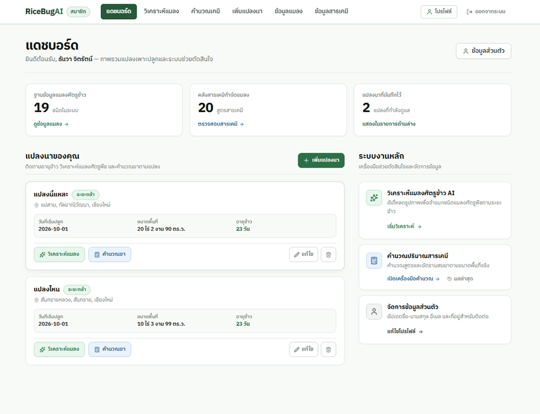
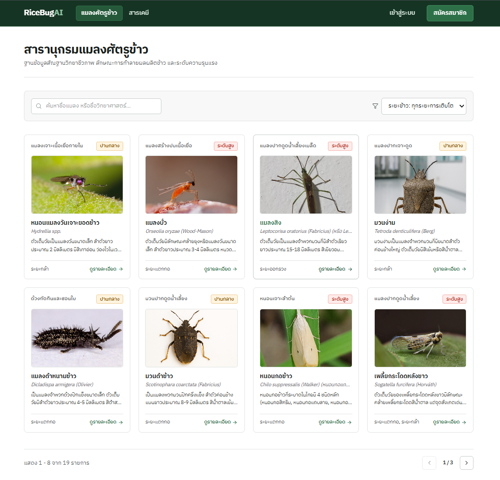
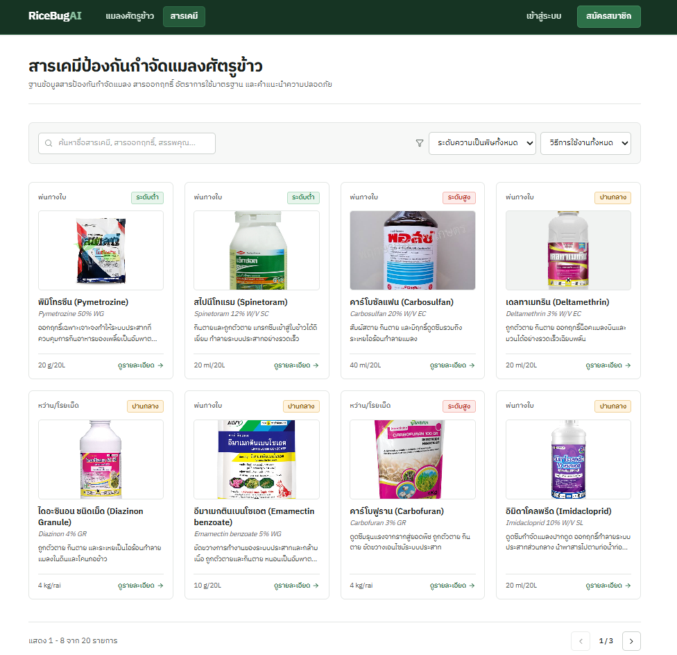
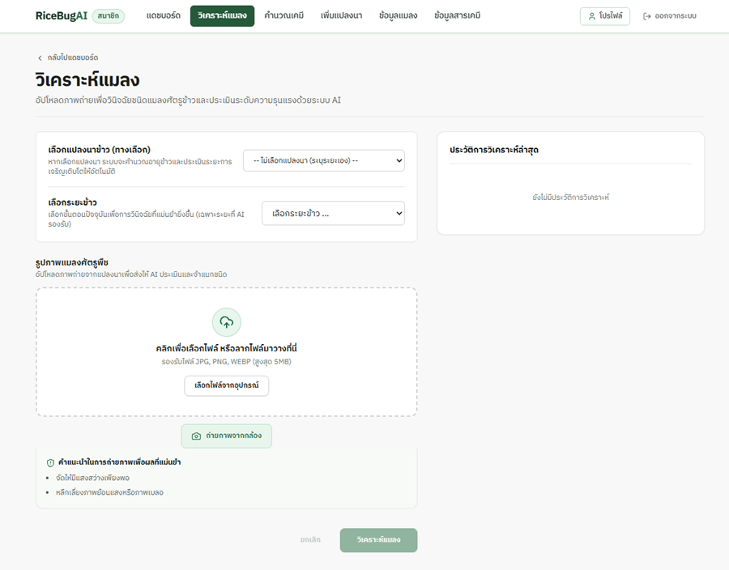
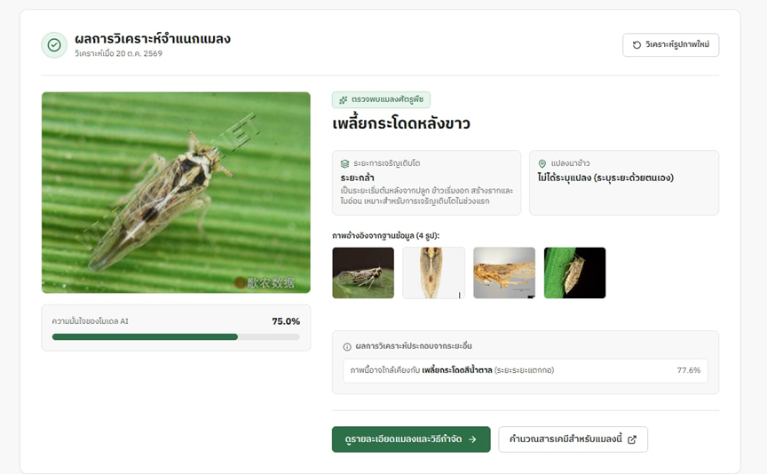
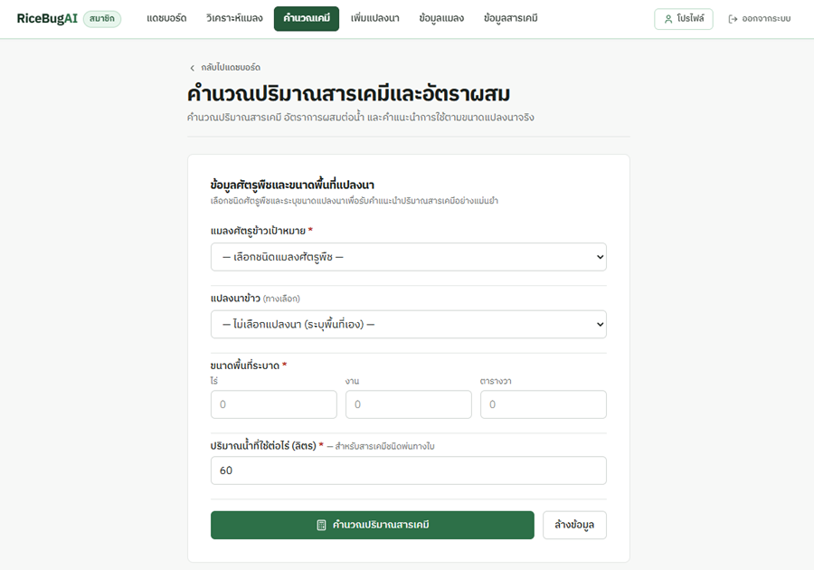
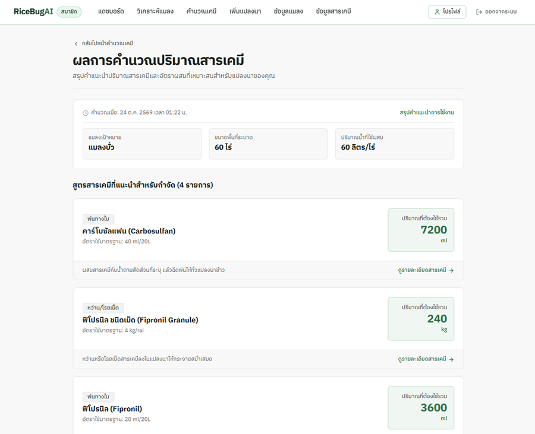

## 🚀 Featured Projects

### 🌾 RiceBugAI

AI-powered rice pest insect analysis system.

A web application that uses AI to identify insect pests in rice fields and helps farmers calculate chemical usage.

**Tech Stack**
- **Frontend:** Next.js, React, TypeScript, Tailwind CSS
- **Backend:** Java, Spring Boot
- **AI:** Python, FastAPI, TensorFlow, MobileNetV2
- **Database:** MySQL

🔗 [View Source Code](https://github.com/Runglang/RiceBugAI)

---

### 📸 Project Screenshots

**1. Dashboard**

**2. Insect Information**

**3. Chemical Information**

**4. Insect Analysis**

**5. Analysis Result**

**6. Chemical Calculation**

**7. Calculation Result**

